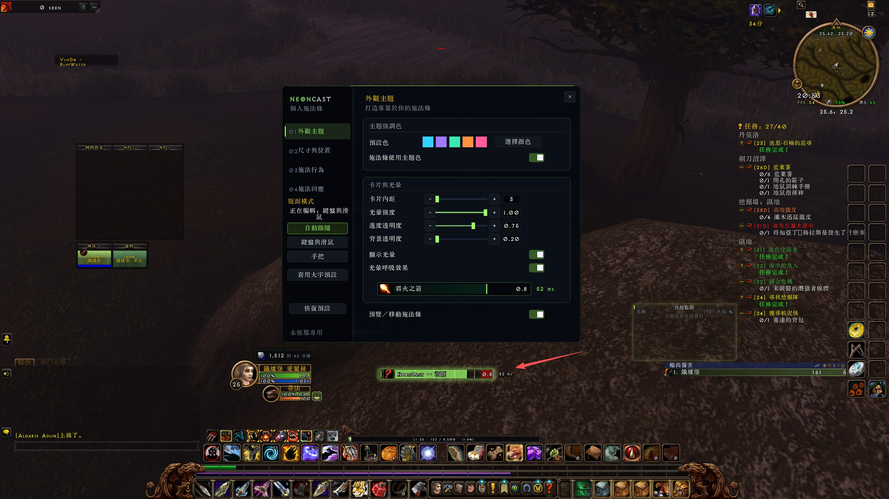

# NeonCast

[English](README.md) | **简体中文** | [繁體中文](README.zh-TW.md)

NeonCast 是《魔兽世界》永恒服的个人施法条插件，基于 Kefer 的 ChromaCast，保留 MIT 授权。

## 安装与使用

从 [GitHub Releases](https://github.com/AreChen/NeonCast/releases) 下载 **NeonCast-<版本>.zip**，解压后将 `NeonCast` 文件夹放入 `Interface/AddOns/NeonCast`，停用 ChromaCast 避免重复显示。输入 `/nc`、`/neoncast` 或点击小地图按钮打开设置。配置按角色保存。

打开设置时仍显示真实施法；启用「预览／移动施法条」后才显示演示并允许拖动。关闭设置或进入战斗会结束预览。也可以使用 X/Y 控件调整位置。设置窗口会根据屏幕空间自动缩放。

支持学派配色、主题预设与自选颜色、光晕、技能图标、剩余时间、引导刻度、批量制造计数及施法队列指示。制造计数要求数量有效且配方 ID 与法术 ID 一致；不满足条件时不猜测进度。

「施法响应」表示施法变更到匹配的开始事件之间的估计耗时，可显示数值与响应区域，不读取或显示网络延迟。`-- ms` 表示本次施法无样本；`0 ms` 可能来自计时精度。支持调整字体、字号和颜色，SharedMedia 字体为可选依赖。

「恢复默认」仅重置插件共用外观和当前布局，保留另一套布局与游戏施法队列时间。「施法行为」页另有将游戏队列恢复为 400 毫秒的独立按钮。

## 原生手柄 UI

- 默认自动跟随游戏当前的界面模式。键鼠与手柄分别保存位置、尺寸、图标大小／显示状态及字号；旧配置迁移到键鼠布局。外观主题和响应字体选择共用。
- 侧栏可选择自动跟随、键鼠或手柄布局；高亮按钮表示已选模式，「正在编辑」显示当前布局。大字预设仅应用于当前布局。
- 在永恒服原生手柄 UI 下，设置窗口接入游戏焦点导航。方向键选择，确认键操作按钮，返回键关闭；数值可通过减号／加号调整，Shift 或原生 HUD 修饰键将步长扩大十倍。颜色预设和上一／下一字体按钮可减少文字输入。
- 游戏按键绑定设置中新增「打开／关闭 NeonCast 设置」和「切换 NeonCast 预览」，不会自动占用或覆盖现有按键。
- 战斗中不打开设置。缺少原生导航接口时仍可用鼠标操作。真实手柄焦点、战斗限制及其他窗口共存需在当前游戏客户端中验证，模拟测试不能替代实机测试。

## 开发与测试

安装 `requirements-dev.txt` 中的依赖，执行 `python -m pytest tests -q`。测试覆盖 Lua 5.1 语法、TOC 加载、布局迁移、施法事件、多语言回退与设置生命周期；窗口测试额外覆盖 Lua 5.5。GitHub Actions 在推送及拉取请求时运行测试。

执行 `python tools/package.py` 生成 `dist/NeonCast-<版本>.zip`。模块边界与新增语言的方式见 [开发说明](docs/DEVELOPMENT.md)。

玩家安装包仅包含运行文件、材质、图标和许可证；GitHub 自动附带的 Source code 压缩包是开发源码。后续直接在 `main` 开发，版本标签触发自动发版，详见[发版流程](docs/RELEASING.md)。
