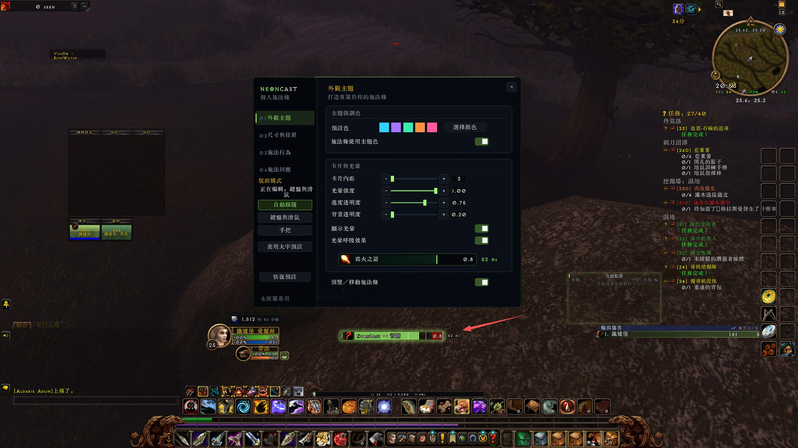

# NeonCast

[English](README.md) | [简体中文](README.zh-CN.md) | **繁體中文**

NeonCast 是《魔獸世界》永恆服的個人施法條插件，基於 Kefer 的 ChromaCast，保留 MIT 授權。

## 安裝與使用

從 [GitHub Releases](https://github.com/AreChen/NeonCast/releases) 下載 **NeonCast-<版本>.zip**，解壓縮後將 `NeonCast` 資料夾放入 `Interface/AddOns/NeonCast`，停用 ChromaCast 以免重複顯示。輸入 `/nc`、`/neoncast` 或點擊小地圖按鈕開啟設定，配置依角色儲存。

開啟設定時仍顯示真實施法；啟用「預覽／移動施法條」後才顯示示範並允許拖曳。關閉設定或進入戰鬥會結束預覽。亦可使用 X/Y 控制項調整位置，設定視窗會依畫面空間縮放。

支援學派配色、主題預設與自訂顏色、光暈、技能圖示、剩餘時間、引導刻度、批量製作計數及施法佇列指示。製作計數需要有效數量且配方 ID 與法術 ID 一致；不符合時不猜測進度。

「施法回應」是施法變更到配對的開始事件之間的估計耗時，可顯示數值與回應區域，不讀取或顯示網路延遲。`-- ms` 表示此次施法無樣本；`0 ms` 可能來自計時精度。可調整字型、大小及顏色，SharedMedia 字型為選用依賴。

「恢復預設」僅重置共用外觀及目前版面，保留另一套版面與遊戲施法佇列時間。「施法行為」頁另有將遊戲佇列恢復為 400 毫秒的獨立按鈕。

## 原生手把 UI

- 預設自動跟隨遊戲目前的介面模式，鍵鼠與手把分別儲存位置、尺寸、圖示大小／顯示狀態及字型大小；舊設定遷移至鍵鼠版面。外觀主題及回應字型選擇共用。
- 側欄可選自動跟隨、鍵鼠或手把版面；高亮按鈕表示所選模式，「正在編輯」顯示目前版面。大字預設僅套用至目前版面。
- 原生手把 UI 下，視窗接入遊戲的焦點導覽。方向鍵選擇，確認鍵操作按鈕，返回鍵關閉；減號／加號可調整數值，Shift 或原生 HUD 修飾鍵將步長擴大十倍。顏色預設及上一／下一字型按鈕可減少文字輸入。
- 遊戲按鍵綁定設定提供「開啟／關閉 NeonCast 設定」及「切換 NeonCast 預覽」，不會自動佔用或覆寫按鍵。
- 戰鬥中不開啟設定。缺少原生導覽介面時仍可使用滑鼠。真實手把焦點、戰鬥限制與其他視窗共存須在目前客戶端驗證，模擬測試不能替代實機測試。

## 開發與測試

安裝 `requirements-dev.txt` 的依賴後執行 `python -m pytest tests -q`。測試涵蓋 Lua 5.1 語法、TOC 載入、版面遷移、施法事件、多語言回退及設定生命週期，視窗測試額外涵蓋 Lua 5.5。GitHub Actions 在推送及拉取請求時執行測試。

執行 `python tools/package.py` 產生 `dist/NeonCast-<版本>.zip`。模組邊界及新增語言方式見 [開發說明](docs/DEVELOPMENT.md)。

玩家安裝包僅包含執行檔案、材質、圖示及授權；GitHub 自動附帶的 Source code 壓縮檔是開發原始碼。後續直接在 `main` 開發，版本標籤觸發自動發版，詳見[發版流程](docs/RELEASING.md)。
